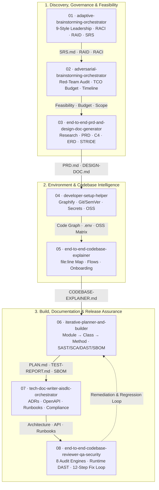

# End-to-End AI-SDLC Orchestrator Skills Suite

An enterprise-grade collection of **8 composable AI-SDLC orchestrator skills** for **Claude Code** and **Antigravity**. Together, they govern the entire software engineering lifecycle—from initial idea discovery, adversarial feasibility stress-testing, and ISO/IEC/IEEE 29148 requirements engineering to system architecture, bottom-up `Module → Class → Method` implementation, technical documentation, and 8-engine QA/AppSec release assurance.

Unlike ad-hoc prompt workflows that jump straight into writing unverified code, this suite enforces **upfront Human-in-the-Loop (HITL) clarification questionnaires**, **mandatory phase-completion stage gates**, **bidirectional traceability**, and **evidence-based verification** at every step.

---

## End-to-End AI-SDLC Pipeline

Each skill produces structured, versioned Markdown and machine-readable artifacts that feed directly into the next stage—supporting both **Greenfield Builds** and **Brownfield Reconstructions**:



---

## The 8 Core Skills Matrix

| # | Skill Name | Lifecycle Stage | Core Capabilities | Key Artifacts Produced |
| :--- | :--- | :--- | :--- | :--- |
| **01** | `adaptive-brainstorming-orchestrator` | Discovery & Requirements | 9-Style Adaptive Leadership Engine, RACI Authority Matrix, RAID register, AS-IS/TO-BE flows, ISO/IEC/IEEE 29148 requirements, 10 scenario classes | `GOVERNANCE-CHARTER.md`, `RAID-REGISTER.md`, `SRS.md` |
| **02** | `adversarial-brainstorming-orchestrator` | Stress-Testing & Feasibility | Bureaucratic, Devil's Advocate & Red-Team opposition loop; SMART goals, CapEx/OpEx TCO math, critical-path schedule, scope kill list | `PROJECT-CHARTER-AND-BRIEF.md`, `FEASIBILITY-AND-REALITY-CHECK.md`, `TECH-AND-BUDGET-PLAN.md` |
| **03** | `end-to-end-prd-and-design-doc-generator` | Product & System Design | Wide competitive/OSS research, conclusive ideation, tech stack ADRs, C4 diagrams, ERDs, API contracts, STRIDE & UX specs | `RESEARCH-AND-IDEATION.md`, `PRD.md`, `DESIGN-DOC.md` |
| **04** | `developer-setup-helper` | Bootstrap & Environment | Installs/runs `graphify` code graph, initializes Git & SemVer, hardens `.gitignore` & secrets, audits gaps, benchmarks modern OSS libraries | `PROJECT-STATUS-AUDIT.md`, `TECH-AND-OSS-RESEARCH.md`, `.env.example` |
| **05** | `end-to-end-codebase-explainer` | Codebase Intelligence | Evidence-based repository mapping (`file:line`), entry points, execution lifecycle, Mermaid sequence diagrams, security posture, onboarding path | `CODEBASE-EXPLAINER.md` |
| **06** | `iterative-planner-and-builder` | Architecture, Build & DevSecOps | Brownfield/greenfield engineering, OSS reuse, 3NF DB design, `Module → Class → Method` WBS, structured JSON logging, mandatory code reviews, SAST/SCA/DAST/SBOM | `ARCHITECTURE-AND-OSS.md`, `DATABASE-DESIGN.md`, `PLAN.md`, `PROGRESS.md`, `TEST-REPORT.md`, `AUDIT-TRAIL.md` |
| **07** | `tech-doc-writer-aisdlc-orchestrator` | Documentation & Handover | Code-to-doc drift audit, ADRs, OpenAPI specs, QA/compliance packs, deployment guides, SRE incident runbooks, release notes | `DOCS-PLAN.md`, `docs/ARCHITECTURE.md`, `docs/API-REFERENCE.md`, `docs/RUNBOOK.md`, `CHANGELOG.md` |
| **08** | `end-to-end-codebase-reviewer-qa-security` | QA, AppSec & Release Gate | 8 specialist audit engines, test-env-only Rules of Engagement, DAST/IAST, AuthZ matrix, 17 business-logic checks, 19 DB checks, 15 frontend checks, supply-chain/crypto/DR, post-deploy risk forecast, 12-step remediation loop | `RULES-OF-ENGAGEMENT.md`, `AUDIT-REPORT.md`, `FINDINGS-REGISTER.md`, `audit-results/*` (`JSON`/`CSV`/`SARIF`/`CycloneDX`/`HTML`) |

---

## Core Architectural Pillars

- **Human-in-the-Loop (HITL) Governance:** Every skill runs upfront clarification questionnaires before acting and enforces mandatory **Phase-Completion Stage Gates**—pausing to summarize verified outputs, preview next steps, and obtain explicit human ratification before advancing.
- **Parallel Specialist Subagent Orchestration:** Automatically scans installed specialist agents (product managers, software/DB/security architects, frontend/UX designers, DevSecOps engineers, and QA reality checkers) and delegates independent analysis, build, and audit streams in parallel—with graceful single-agent fallback if a specialist is absent.
- **Zero-Boilerplate OSS Reuse:** Evaluates mature open-source frameworks and libraries before writing custom code, documenting trade-offs, licenses, and CVEs in a structured adoption matrix.
- **Bottom-Up Verification & Audit Trails:** Tracks execution state across restarts via persistent files (`PLAN.md`, `PROGRESS.md`, `TEST-REPORT.md`, `AUDIT-TRAIL.md`), requiring real command/test evidence before marking any Method, Class, Module, or Requirement `PASSED`.
- **Hard Safety & Test-Environment Boundaries:** Enforces strict read-only codebase inspection during audits, isolated sandbox execution, and explicit test-environment-only Rules of Engagement (never touching live production or unauthorized CI/CD surfaces).

---

## Prerequisites

### 1. Install Specialist Subagents (Recommended)
These orchestrator skills delegate specialized tasks to domain agents (architects, engineers, designers, security auditors, and QA checkers). Install the specialist catalog using the **Agency Agents App**:

👉 **[Download Agency Agents App](https://github.com/msitarzewski/agency-agents-app)** *(macOS, Windows, and Linux)*

```bash
# macOS Homebrew installation
brew tap msitarzewski/agency-agents
brew trust --cask msitarzewski/agency-agents/agency-agents
brew install --cask agency-agents
```

Deploy the specialist personas into your **Claude Code** and/or **Antigravity** environment. *(If any specialist skill is not installed, each orchestrator includes built-in fallback coverage.)*

### 2. Optional Tooling
- **Git** (`>= 2.30`) for repository versioning and baseline commit tracking.
- **Graphify** (prompted automatically by Skill `04` if not yet installed) for structural code-graph generation.

---

## Repository Structure

```text
.
├── adaptive-brainstorming-orchestrator/
│   └── SKILL.md
├── adversarial-brainstorming-orchestrator/
│   └── SKILL.md
├── end-to-end-prd-and-design-doc-generator/
│   └── SKILL.md
├── developer-setup-helper/
│   └── SKILL.md
├── end-to-end-codebase-explainer/
│   └── SKILL.md
├── iterative-planner-and-builder/
│   └── SKILL.md
├── tech-doc-writer-aisdlc-orchestrator/
│   └── SKILL.md
├── end-to-end-codebase-reviewer-qa-security/
│   └── SKILL.md
└── README.md
```

---

## Installation

### Claude Code

**Global installation** (available across all repositories):
```bash
mkdir -p ~/.claude/skills
cp -r adaptive-brainstorming-orchestrator \
      adversarial-brainstorming-orchestrator \
      end-to-end-prd-and-design-doc-generator \
      developer-setup-helper \
      end-to-end-codebase-explainer \
      iterative-planner-and-builder \
      tech-doc-writer-aisdlc-orchestrator \
      end-to-end-codebase-reviewer-qa-security \
      ~/.claude/skills/
```

**Project-level installation** (committed to a single repository):
```bash
mkdir -p .claude/skills
cp -r *-orchestrator *-generator *-helper *-explainer *-builder *-security .claude/skills/
```

### Antigravity

Copy the skill folders into your workspace `.agent/skills/` directory (or your global Antigravity skills directory):
```bash
mkdir -p .agent/skills
cp -r *-orchestrator *-generator *-helper *-explainer *-builder *-security .agent/skills/
```

---

## Quickstart Workflows

### Scenario A: Greenfield Product (Idea → Production-Ready Build)
1. **Elicit & Structure Requirements:**
   ```text
   Use adaptive-brainstorming-orchestrator to define scope, RACI governance, RAID risks, and an ISO/IEC/IEEE 29148 SRS.md for [describe your product idea].
   ```
2. **Red-Team & Stress-Test Feasibility:**
   ```text
   Use adversarial-brainstorming-orchestrator to challenge our assumptions, audit CapEx/OpEx TCO budget and timeline, and lock a trimmed v1 scope.
   ```
3. **Generate PRD & Technical Design:**
   ```text
   Use end-to-end-prd-and-design-doc-generator to create PRD.md and DESIGN-DOC.md with C4 diagrams, ERDs, API contracts, and STRIDE threat modeling.
   ```
4. **Bootstrap Environment & Implement Bottom-Up:**
   ```text
   Use developer-setup-helper to initialize Git, .gitignore, secrets hygiene, and OSS library benchmarks, then run iterative-planner-and-builder to build and verify the application Module by Module.
   ```
5. **Document & Run Release Assurance Gate:**
   ```text
   Use tech-doc-writer-aisdlc-orchestrator to generate architecture, API, and SRE runbook docs, then run end-to-end-codebase-reviewer-qa-security in our test environment for final release sign-off.
   ```

### Scenario B: Brownfield Repository (Onboarding, Audit & Refactoring)
1. **Map & Explain Existing Code:**
   ```text
   Use developer-setup-helper and end-to-end-codebase-explainer to build a Graphify code graph, audit environment/secrets hygiene, and generate CODEBASE-EXPLAINER.md.
   ```
2. **Audit Quality, QA & Security:**
   ```text
   Use end-to-end-codebase-reviewer-qa-security to audit this repository against our authorized test environment and generate AUDIT-REPORT.md with a post-deployment risk forecast.
   ```
3. **Reconstruct & Harden Iteratively:**
   ```text
   Use iterative-planner-and-builder in brownfield reconstruction mode to plan and implement approved fixes and new modules with full regression and DevSecOps gates.
   ```

### Scenario C: Resume Interrupted Execution
All planning, build, and audit skills persist state in Markdown tracking files (`PLAN.md`, `PROGRESS.md`, `TEST-REPORT.md`, `AUDIT-TRAIL.md`, `FINDINGS-REGISTER.md`):
```text
Resume execution from the last verified checkpoint in PROGRESS.md and PLAN.md.
```

---

## Skill Details

### 01 · `adaptive-brainstorming-orchestrator`
- **Role:** Situational & Enterprise Governance Orchestrator.
- **How It Works:** Dynamically shifts across **9 leadership archetypes** (*Situational, Charismatic/Visionary, Transformational, Coaching, Democratic, Servant, Transactional, Laissez-Faire, and Autocratic*) to resolve stakeholder ambiguity, build a **RACI Authority Matrix**, maintain a **RAID Register**, map **AS-IS / TO-BE** workflows, and compile an **ISO/IEC/IEEE 29148 `SRS.md`** covering 8 requirement classes and 10 scenario types.

### 02 · `adversarial-brainstorming-orchestrator`
- **Role:** Bureaucratic Gatekeeper, Devil's Advocate & Red-Team Auditor.
- **How It Works:** Actively opposes every unverified assumption, optimistic deadline, and bloated feature request via a structured **Audit & Counter-Loop**. Forces SMART goals, line-item CapEx/OpEx TCO math, critical-path schedules with risk-adjusted contingency buffers, and an explicit **Out-of-Scope Kill List**.

### 03 · `end-to-end-prd-and-design-doc-generator`
- **Role:** Lead Product & Architecture Orchestrator.
- **How It Works:** Conducts wide competitive and open-source research, synthesizes 2–3 competing product theses into one justified direction, records Architecture Decision Records (`ADR-xxx`), and generates decision-complete `PRD.md` and `DESIGN-DOC.md` specifications (C4 diagrams, normalized ERDs, OpenAPI contracts, STRIDE threat models, and UX edge states).

### 04 · `developer-setup-helper`
- **Role:** Developer Environment & Bootstrap Orchestrator.
- **How It Works:** Verifies and runs `graphify` to map symbol/dependency graphs, initializes Git and Semantic Versioning, hardens `.gitignore` and `.env.example`, scans for exposed keys/credentials, audits completed vs. unbuilt code, and benchmarks modern open-source libraries with a Pros & Cons matrix.

### 05 · `end-to-end-codebase-explainer`
- **Role:** Lead Codebase Analyst.
- **How It Works:** Performs a read-only, evidence-backed investigation citing exact `file:line` references—documenting tech stack versions, C4/sequence Mermaid diagrams, entry points, end-to-end data flows, security posture, outdated `README.md` contradictions, and a prioritized First-Day Reading Path.

### 06 · `iterative-planner-and-builder`
- **Role:** Enterprise Engineering & Governance Orchestrator.
- **How It Works:** Decomposes systems in strict dependency/data-flow order (`Module → Class → Method`), enforces 3NF database design, structured JSON logging with PII redaction, mandatory `engineering-code-reviewer` gates, and shift-left **SAST, SCA, DAST, and CycloneDX/SPDX SBOM** verification—backed by `PLAN.md`, `PROGRESS.md`, `TEST-REPORT.md`, and `AUDIT-TRAIL.md`.

### 07 · `tech-doc-writer-aisdlc-orchestrator`
- **Role:** Technical Documentation & AI-SDLC Synchronization Orchestrator.
- **How It Works:** Audits code-to-doc drift across all upstream AI-SDLC artifacts and generates synchronized engineering and operational documentation (`docs/ARCHITECTURE.md`, `docs/adr/ADR-*.md`, `docs/DATA-MODEL.md`, `docs/API-REFERENCE.md`, `docs/SECURITY-AND-COMPLIANCE.md`, `docs/DEPLOYMENT.md`, `docs/RUNBOOK.md`, and `CHANGELOG.md`).

### 08 · `end-to-end-codebase-reviewer-qa-security`
- **Role:** Lead Assurance, QA & Security Orchestrator.
- **How It Works:** Operates across **8 separated specialist audit engines** within a strict test-environment-only `RULES-OF-ENGAGEMENT.md` boundary. Executes automated baselines, runtime DAST/IAST, actor-to-resource AuthZ matrices, **17 business-logic abuse checks**, **19 database security/integrity checks**, **15 frontend/accessibility checks**, **14 supply-chain checks**, **15 cryptography/identity checks**, **12 backup/DR restore checks**, a mandatory **Post-Deployment Risk Forecast**, **6 independent release verdicts**, machine-readable exports (`JSON`, `CSV`, `SARIF`, `CycloneDX`, `HTML`), and a write-authorized **12-step remediation loop**.

---

## License

MIT
