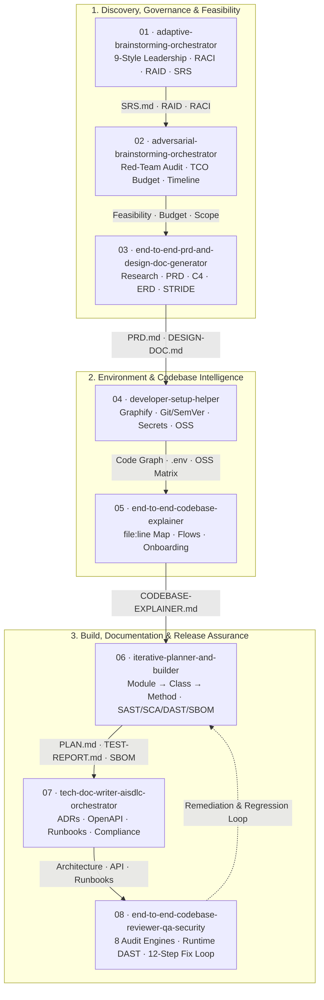

# End-to-End AI-SDLC Orchestrator Skills Suite

An enterprise-grade collection of **8 composable AI-SDLC orchestrator skills** for **Claude Code** and **Antigravity**. Together, they govern the entire software engineering lifecycle—from initial idea discovery, adversarial feasibility stress-testing, and ISO/IEC/IEEE 29148 requirements engineering to system architecture, bottom-up `Module → Class → Method` implementation, technical documentation, and 8-engine QA/AppSec release assurance.

Unlike ad-hoc prompt workflows that jump straight into writing unverified code, this suite enforces **upfront Human-in-the-Loop (HITL) clarification questionnaires**, **mandatory phase-completion stage gates**, **bidirectional traceability**, and **evidence-based verification** at every step.

---

## End-to-End SDLC Pipeline

Each skill produces structured, versioned Markdown and machine-readable artefacts that feed directly into the next stage—supporting both **Greenfield Builds** and **Brownfield Reconstructions**:



## Core Architectural Pillars

- **Human-in-the-Loop (HITL) Governance:** Every skill runs upfront clarification questionnaires before acting and enforces mandatory **Phase-Completion Stage Gates**—pausing to summarize verified outputs, preview next steps, and obtain explicit human ratification before advancing.
- **Parallel Specialist Subagent Orchestration:** Automatically scans installed specialist agents (product managers, software/DB/security architects, frontend/UX designers, DevSecOps engineers, and QA reality checkers) and delegates independent analysis, build, and audit streams in parallel—with graceful single-agent fallback if a specialist is absent.
- **Zero-Boilerplate OSS Reuse:** Evaluates mature open-source frameworks and libraries before writing custom code, documenting trade-offs, licenses, and CVEs in a structured adoption matrix.
- **Bottom-Up Verification & Audit Trails:** Tracks execution state across restarts via persistent files (`PLAN.md`, `PROGRESS.md`, `TEST-REPORT.md`, `AUDIT-TRAIL.md`), requiring real command/test evidence before marking any Method, Class, Module, or Requirement `PASSED`.
- **Hard Safety & Test-Environment Boundaries:** Enforces strict read-only codebase inspection during audits, isolated sandbox execution, and explicit test-environment-only Rules of Engagement (never touching live production or unauthorized CI/CD surfaces).

---

## Prerequisites

### 1. Install Specialist Subagents (Recommended)
These orchestrator skills delegate specialized tasks to domain agents (architects, engineers, designers, security auditors, and QA checkers). Install the specialist catalog using the **Agency Agents App**:

👉 **[Download Agency Agents App](https://github.com/msitarzewski/agency-agents-app)** *(macOS, Windows, and Linux)*

```bash
# macOS Homebrew installation
brew tap msitarzewski/agency-agents
brew trust --cask msitarzewski/agency-agents/agency-agents
brew install --cask agency-agents
```

Deploy the specialist personas into your **Claude Code** and/or **Antigravity** environment. *(If any specialist skill is not installed, each orchestrator includes built-in fallback coverage.)*

### 2. Optional Tooling
- **Git** (`>= 2.30`) for repository versioning and baseline commit tracking.
- **Graphify** (prompted automatically by Skill `04` if not yet installed) for structural code-graph generation.

---

## Repository Structure

```text
.
├── adaptive-brainstorming-orchestrator/
│   └── SKILL.md
├── adversarial-brainstorming-orchestrator/
│   └── SKILL.md
├── end-to-end-prd-and-design-doc-generator/
│   └── SKILL.md
├── developer-setup-helper/
│   └── SKILL.md
├── end-to-end-codebase-explainer/
│   └── SKILL.md
├── iterative-planner-and-builder/
│   └── SKILL.md
├── tech-doc-writer-aisdlc-orchestrator/
│   └── SKILL.md
├── end-to-end-codebase-reviewer-qa-security/
│   └── SKILL.md
└── README.md
```

---

## Installation

### Claude Code

**Global installation** (available across all repositories):
```bash
mkdir -p ~/.claude/skills
cp -r adaptive-brainstorming-orchestrator \
      adversarial-brainstorming-orchestrator \
      end-to-end-prd-and-design-doc-generator \
      developer-setup-helper \
      end-to-end-codebase-explainer \
      iterative-planner-and-builder \
      tech-doc-writer-aisdlc-orchestrator \
      end-to-end-codebase-reviewer-qa-security \
      ~/.claude/skills/
```

**Project-level installation** (committed to a single repository):
```bash
mkdir -p .claude/skills
cp -r *-orchestrator *-generator *-helper *-explainer *-builder *-security .claude/skills/
```

### Antigravity

Copy the skill folders into your workspace `.agent/skills/` directory (or your global Antigravity skills directory):
```bash
mkdir -p .agent/skills
cp -r *-orchestrator *-generator *-helper *-explainer *-builder *-security .agent/skills/
```

---

## Quickstart Workflows

### Scenario A: Greenfield Product (Idea → Production-Ready Build)
1. **Elicit & Structure Requirements:**
   ```text
   Use adaptive-brainstorming-orchestrator to define scope, RACI governance, RAID risks, and an ISO/IEC/IEEE 29148 SRS.md for [describe your product idea].
   ```
2. **Red-Team & Stress-Test Feasibility:**
   ```text
   Use adversarial-brainstorming-orchestrator to challenge our assumptions, audit CapEx/OpEx TCO budget and timeline, and lock a trimmed v1 scope.
   ```
3. **Generate PRD & Technical Design:**
   ```text
   Use end-to-end-prd-and-design-doc-generator to create PRD.md and DESIGN-DOC.md with C4 diagrams, ERDs, API contracts, and STRIDE threat modeling.
   ```
4. **Bootstrap Environment & Implement Bottom-Up:**
   ```text
   Use developer-setup-helper to initialize Git, .gitignore, secrets hygiene, and OSS library benchmarks, then run iterative-planner-and-builder to build and verify the application Module by Module.
   ```
5. **Document & Run Release Assurance Gate:**
   ```text
   Use tech-doc-writer-aisdlc-orchestrator to generate architecture, API, and SRE runbook docs, then run end-to-end-codebase-reviewer-qa-security in our test environment for final release sign-off.
   ```

### Scenario B: Brownfield Repository (Onboarding, Audit & Refactoring)
1. **Map & Explain Existing Code:**
   ```text
   Use developer-setup-helper and end-to-end-codebase-explainer to build a Graphify code graph, audit environment/secrets hygiene, and generate CODEBASE-EXPLAINER.md.
   ```
2. **Audit Quality, QA & Security:**
   ```text
   Use end-to-end-codebase-reviewer-qa-security to audit this repository against our authorized test environment and generate AUDIT-REPORT.md with a post-deployment risk forecast.
   ```
3. **Reconstruct & Harden Iteratively:**
   ```text
   Use iterative-planner-and-builder in brownfield reconstruction mode to plan and implement approved fixes and new modules with full regression and DevSecOps gates.
   ```

### Scenario C: Resume Interrupted Execution
All planning, build, and audit skills persist state in Markdown tracking files (`PLAN.md`, `PROGRESS.md`, `TEST-REPORT.md`, `AUDIT-TRAIL.md`, `FINDINGS-REGISTER.md`):
```text
Resume execution from the last verified checkpoint in PROGRESS.md and PLAN.md.
```


## License

MIT
